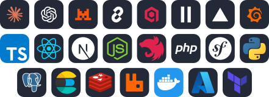

<picture><source media="(prefers-color-scheme: light)" srcset="assets/hero-light.svg"/></picture>

I turn messy business processes into software people actually use: AI agents that take work off a team's plate, search that finds the right document, and the cloud setup that keeps it all running. Ten years of full-stack work, from PHP backends to LLM pipelines.

<picture><source media="(prefers-color-scheme: light)" srcset="assets/terminal-light.svg"/></picture>

### How my stack fits together

<picture><source media="(prefers-color-scheme: light)" srcset="assets/stack-light.svg"/></picture>

  <picture><source media="(prefers-color-scheme: light)" srcset="assets/stack-icons-light.svg"/></picture>

Full list

| | |
|---|---|
| **AI** | Claude (API, Agent SDK, Claude Code), OpenAI, Azure OpenAI, Mistral AI, LangChain, Vercel AI SDK, MCP, RAG, Qdrant, Langfuse, ElevenLabs |
| **Automation** | n8n, Azure Durable Functions, scheduled Claude agents, RabbitMQ |
| **Frontend** | TypeScript, React, Next.js, Svelte |
| **Backend** | Node.js, NestJS, PHP, Symfony, Python |
| **Data** | PostgreSQL, Elasticsearch, Redis, Qdrant |
| **Cloud & DevOps** | Microsoft Azure, Terraform, Docker, GitHub Actions, Grafana |

### Career

<picture><source media="(prefers-color-scheme: light)" srcset="assets/career-light.svg"/></picture>

### Open source

<a href="https://github.com/Keized/sncf-mcp"><picture><source media="(prefers-color-scheme: light)" srcset="assets/sncf-mcp-light.svg"/></picture></a>

<a href="https://github.com/Keized/react-hooks-hub"><picture><source media="(prefers-color-scheme: light)" srcset="https://github-readme-stats.vercel.app/api/pin/?username=keized&repo=react-hooks-hub&bg_color=f7f4ee&title_color=1b2430&text_color=5b6470&icon_color=e0501a&border_color=d8d1c4"/></picture></a>

<picture><source media="(prefers-color-scheme: light)" srcset="https://github-readme-stats.vercel.app/api?username=keized&show_icons=true&include_all_commits=true&count_private=true&bg_color=f7f4ee&title_color=1b2430&text_color=5b6470&icon_color=e0501a&border_color=d8d1c4"/></picture>
<picture><source media="(prefers-color-scheme: light)" srcset="https://github-readme-stats.vercel.app/api/top-langs/?username=keized&layout=compact&langs_count=8&bg_color=f7f4ee&title_color=1b2430&text_color=5b6470&border_color=d8d1c4"/></picture>

### Contact

[LinkedIn](https://www.linkedin.com/in/kevin-fiseneck/)
